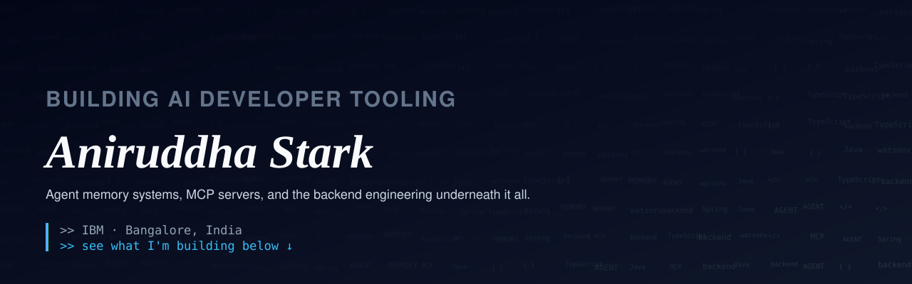
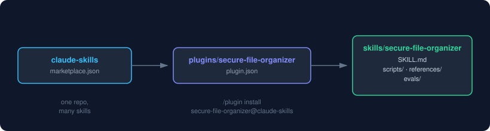
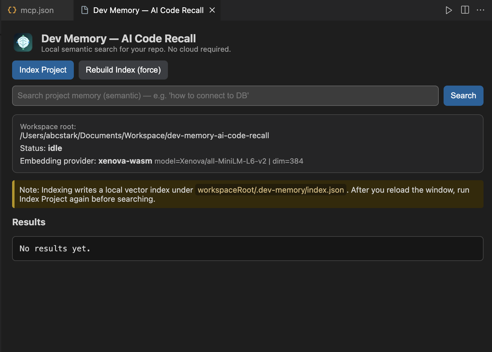
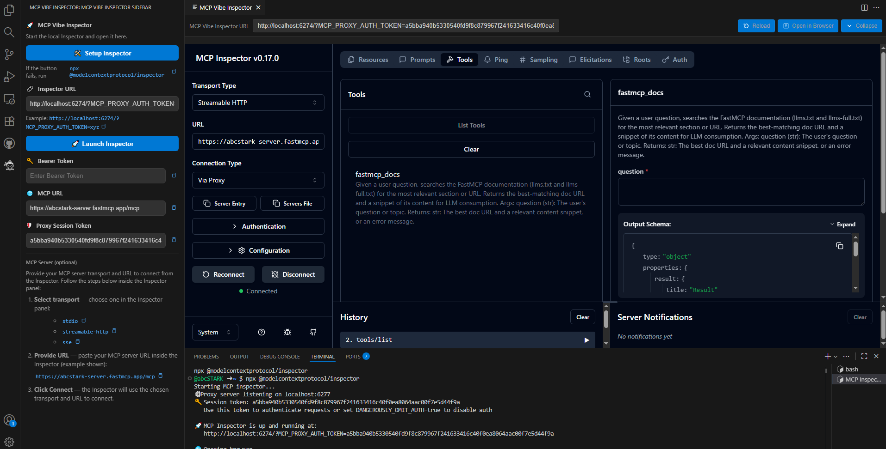

<div align="center">



<br/>

[](https://www.youtube.com/channel/UCvMjA3m4Ui3V6dE9CkjP34Q)
[](https://x.com/AniruddhaStark)

</div>

---

## What I'm building

**[claude-skills](https://github.com/abcSTARK/claude-skills)** · *actively growing*
A Claude Code plugin marketplace I'm building up over time. Each skill starts as a real problem solved end-to-end, then gets generalized and tested (with-skill vs. baseline comparisons) before being added.

 plugin -> skill" width="700"/>

```
/plugin marketplace add abcSTARK/claude-skills
/plugin install secure-file-organizer@claude-skills
```

**[dev-memory-ai-code-recall](https://github.com/abcSTARK/dev-memory-ai-code-recall)**
Local-first memory engine for AI coding agents — lets an agent recall prior context across sessions without shipping your codebase to a third party.



**[vscode-mcp-debugger](https://github.com/abcSTARK/vscode-mcp-debugger)** · *MCP Vibe Inspector*
VS Code extension to debug and inspect Model Context Protocol servers right inside the editor — launch, configure, and inspect multiple MCP servers without ever leaving VS Code or switching to a browser.



**[vscode-llm-fastmcp-context](https://github.com/abcSTARK/vscode-llm-fastmcp-context)**
Adds a FastMCP-powered LLM context server to a VS Code workspace, giving coding agents richer, structured project context.

**[team-wellbeing-agent](https://github.com/abcSTARK/team-wellbeing-agent)**
AI agent built on IBM watsonx Orchestrate that monitors team-health signals and proactively surfaces burnout/disengagement risk — a module of the AskManager platform.

**[SG_HackerVerse_CO2_Emission](https://github.com/abcSTARK/SG_HackerVerse_CO2_Emission)**
Data/AI project predicting CO2 emissions from transaction data, built for SG Hackerverse.

## Backend foundation

**[Restaurant-API-Spring-security](https://github.com/abcSTARK/Restaurant-API-Spring-security)**
Spring Security + Swagger UI + DB-backed role-based auth + Spring AOP, with JUnit 5 and Mockito test coverage — the kind of groundwork the AI tooling above sits on.

---

## Stack


---

<div align="center">
<sub>Older coursework and learning-exercise repos aren't pinned above but are still on my profile — I keep them around as a record of the fundamentals, not as current work.</sub>
</div>
